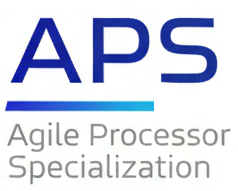
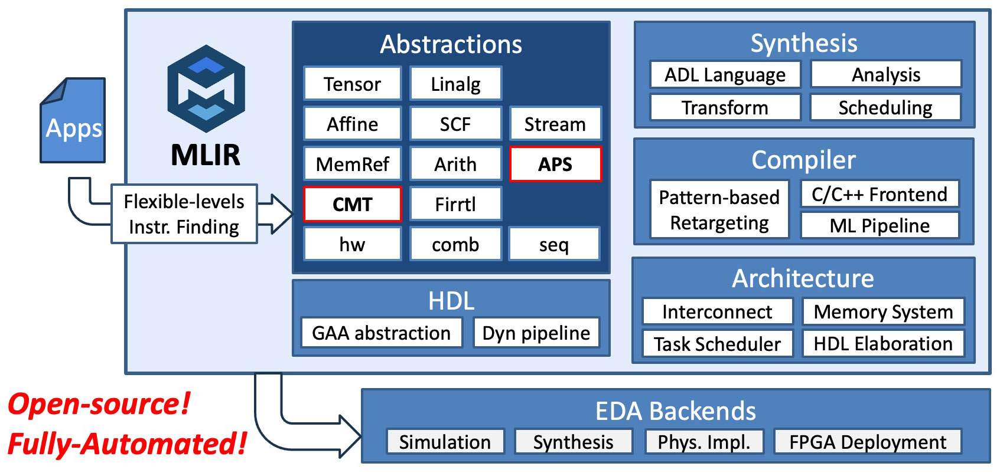

# APS: Agile Processor Specialization

APS (Agile Processor Specialization) is an open-source framework for hardware-software co-design of domain-specific RISC-V processors. It covers instruction finding, hardware synthesis, software compilation, and architecture integration for instruction-set extensions (ISAXs).

## Quick Links

- **Home page:** [http://aps.ericlyun.me/](http://aps.ericlyun.me/)
- **Publications:** [http://aps.ericlyun.me/publications/](http://aps.ericlyun.me/publications/)
- **Tutorials:** [http://aps.ericlyun.me/tutorials/](http://aps.ericlyun.me/tutorials/)

## APS's Ecosystem



APS aims to build a comprehensive ecosystem based on the MLIR infrastructure, covering the entire hardware-software co-design flow. Our ultimate vision is to only take applications in the target domain as the inputs, and automatically generate the complete solution artifacts comprising optimized ISAXs, architecture designs, hardware implementation, and software stacks without any manual intervention.

## Overview

The framework consists of four major components:

### Instruction Finding

Finds useful custom instructions from application code:

- **ISAMORE / ScaleISA**: Discovers candidate instruction extensions from application MLIR and selects implementations under area and timing constraints.
- **APS Integration**: Adapts selected candidates for hardware synthesis and software compilation. The [ScaleISA driver](docs/COMPILER/aps-scaleisa-opt.md) coordinates discovery, selection, code generation, and optional validation.

### Hardware Synthesis

- **CADL**: A high-level domain-specific language for describing ISAXs (Instruction Set Architecture eXtensions). CADL provides intuitive syntax for register file access, memory operations, bit manipulation, and loop constructs, allowing designers to focus on algorithm logic rather than hardware details.
- **MLIR Passes**: Loop unrolling, array partitioning, SDC-based scheduling, and RTL generation through CMT2 → FIRRTL → SystemVerilog.

### Compiler

Compiles application software to use custom instructions:

- **Megg**: Uses e-graph matching and rewriting to replace application computations with supplied custom instructions.
- **ScaleISA Software Lowering**: Lowers selected custom-instruction calls to RISC-V code with matching operand and CSR bindings.
- **C/C++ Frontend**: Integration with Polygeist/cgeist for C/C++ to MLIR conversion.
- **LLVM Backend**: Code generation targeting RISC-V with custom instruction encodings.

### Architecture and System Integration

Specializes the accelerator's memory organization and its connection to the processor:

- **Configurable Memory Interfaces**: Models bandwidth, transaction limits, latency, and outstanding requests to guide memory-access selection and scheduling.
- **Banked Scratchpads and DMA**: Generates partitioned local memories and burst-transfer adapters around the workload's data layout and parallelism.
- **Rocket/RoCC Integration**: Exports matching accelerator ports, CSR bindings, and Chipyard configuration from the same hardware and interface descriptions.
- **Spike + Verilator Co-simulation**: [aps-cosim](tools/aps-cosim/) runs compiled RISC-V programs with generated accelerator RTL, validating instruction results, CSR transport, and memory effects end to end.
- **Full-System Evaluation**: Chipyard integrates the accelerator into Rocket for complete SoC RTL simulation and processor-cycle measurements.

See the [processor integration guide](docs/ARCHITECTURE/README.md) and
[co-simulation guide](docs/SYNTHESIS/aps-spike-verilator-cosim.md) for setup and execution.

## Getting Started

### Prerequisites

- Linux (Ubuntu 22.04 recommended)
- [Pixi](https://pixi.sh/) package manager

### Installation

```bash
# 1. Clone the repository
git clone https://github.com/pku-liang/aps-mlir.git
cd aps-mlir
# 2. Build APS toolchain
pixi run build
# 3. Setup Chipyard
pixi run setup-chipyard
```

`pixi run build` also builds `build/tools/scaleisa-opt/scaleisa-opt` and the Rust
engine at `scaleisa/tools/scaleisa-engine/target/release/scaleisa-engine`.

### Quick Start

The `examples/aspdac26-tutorial/` directory contains example CADL files and scripts. Here's a simple example (`examples/aspdac26-tutorial/cadl/hello.cadl`):

```cadl
#[opcode(7'b0101011)]
#[funct7(7'b0000000)]
rtype hello(rs1: u5, rs2: u5, rd: u5) {
  let a: u32 = _irf[rs1];
  let b: u32 = _irf[rs2];
  let c: u32 = a + b;
  _irf[rd] = c;
}
```

See the `examples/aspdac26-tutorial/` directory for more examples including matrix operations (`vgemv3d.cadl`) and distance calculations (`v3ddist_vv.cadl`).

#### CADL Editor Support

VS Code and Zed syntax-highlighting extensions are available in
[`editors/cadl/`](editors/cadl/README.md), with build, installation, and testing
instructions. Both recognize `.cadl` files and follow the current frontend grammar.

#### Full ASIP Pipeline
```bash
# Synthesize CADL to hardware
./examples/aspdac26-tutorial/a1-ex1synth.sh
# Compile test program with custom instruction
./examples/aspdac26-tutorial/a2-ex1compile.sh
# Full SoC simulation and synthesis
./examples/aspdac26-tutorial/a6-ex1sim.sh
./examples/aspdac26-tutorial/a7-ex1yosys.sh
```

## Cite us

If you use APS or its components, please cite the relevant papers:

- [ScaleISA](https://doi.org/10.1145/3845814.3850048), ASPLOS 2027.
- [Aquas](https://doi.org/10.1145/3831252.3834028), ICCAD 2026.
- [ISAMORE](https://doi.org/10.1145/3779212.3790162), ASPLOS 2026.
- [APS](https://doi.org/10.1109/ICCAD66269.2025.11240817), ICCAD 2025.
- [Cement](https://doi.org/10.1145/3626202.3637561), FPGA 2024.
- [HECTOR](https://doi.org/10.1145/3508352.3549370), ICCAD 2022.

<details>
<summary>BibTeX</summary>

```bibtex
@inproceedings{zou2026aquas,
  author = {Zou, Yuyang and Xiao, Youwei and Yin, Chenyun and Xu, Yansong and Luo, Yuhao and Sun, Yitian and Xu, Ruifan and Chen, Renze and Liang, Yun},
  title = {{Aquas}: Enhancing Domain Specialization through Holistic Hardware-Software Co-Optimization based on {MLIR}},
  booktitle = {IEEE/ACM International Conference on Computer-Aided Design (ICCAD)},
  year = {2026},
  location = {San Jose, CA, USA},
  isbn = {979-8-4007-2873-0},
  doi = {10.1145/3831252.3834028}
}

@inproceedings{sun2027scaleisa,
  author = {Sun, Yitian and Xiao, Youwei and Zou, Yuyang and Yin, Chenyun and Liang, Yun},
  title = {Customizing Scalable Instructions via Multi-Level E-Graph Anti-Unification},
  booktitle = {Proceedings of the 32nd ACM International Conference on Architectural Support for Programming Languages and Operating Systems, Volume 1},
  series = {ASPLOS '27},
  year = {2027},
  numpages = {16},
  location = {Heraklion, Greece},
  isbn = {979-8-4007-3012-2},
  doi = {10.1145/3845814.3850048}
}

@inproceedings{xiao2026isamore,
  author = {Xiao, Youwei and Yin, Chenyun and Sun, Yitian and Zou, Yuyang and Liang, Yun},
  title = {Finding Reusable Instructions via E-Graph Anti-Unification},
  booktitle = {Proceedings of the 31st ACM International Conference on Architectural Support for Programming Languages and Operating Systems, Volume 2},
  series = {ASPLOS '26},
  year = {2026},
  pages = {749--763},
  isbn = {9798400723599},
  doi = {10.1145/3779212.3790162}
}

@inproceedings{xiao2025aps,
  author = {Xiao, Youwei and Zou, Yuyang and Xu, Yansong and Luo, Yuhao and Sun, Yitian and Yin, Chenyun and Xu, Ruifan and Chen, Renze and Liang, Yun},
  title = {Invited Paper: {APS}: Open-Source Hardware-Software Co-Design Framework for Agile Processor Specialization},
  booktitle = {2025 IEEE/ACM International Conference on Computer Aided Design (ICCAD)},
  year = {2025},
  pages = {1--9},
  doi = {10.1109/ICCAD66269.2025.11240817}
}

@inproceedings{xiao2024cement,
  author = {Xiao, Youwei and Luo, Zizhang and Zhou, Kexing and Liang, Yun},
  title = {{Cement}: Streamlining {FPGA} Hardware Design with Cycle-Deterministic {eHDL} and Synthesis},
  booktitle = {Proceedings of the 2024 ACM/SIGDA International Symposium on Field Programmable Gate Arrays},
  series = {FPGA '24},
  year = {2024},
  pages = {211--222},
  location = {Monterey, CA, USA},
  isbn = {9798400704185},
  doi = {10.1145/3626202.3637561}
}

@inproceedings{xu2022hector,
  author = {Xu, Ruifan and Xiao, Youwei and Luo, Jin and Liang, Yun},
  title = {{HECTOR}: A Multi-Level Intermediate Representation for Hardware Synthesis Methodologies},
  booktitle = {Proceedings of the 41st IEEE/ACM International Conference on Computer-Aided Design},
  series = {ICCAD '22},
  year = {2022},
  articleno = {54},
  numpages = {9},
  location = {San Diego, California},
  isbn = {9781450392174},
  doi = {10.1145/3508352.3549370}
}
```

</details>
